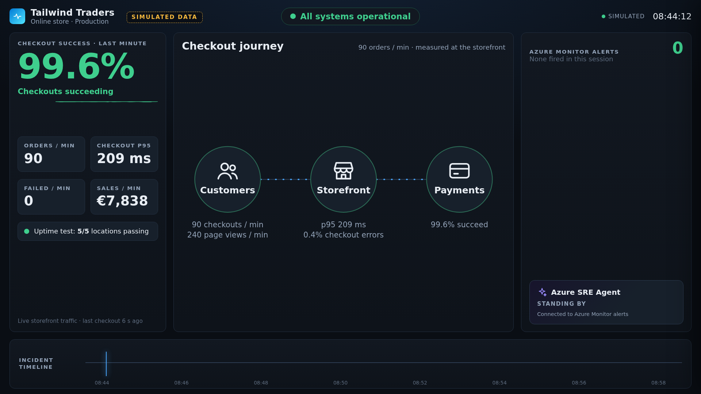
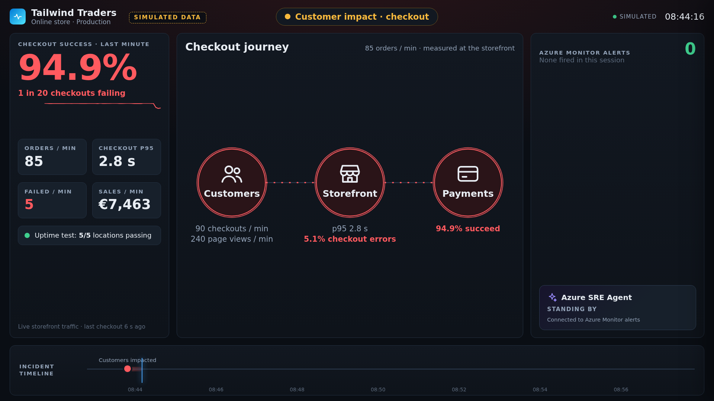
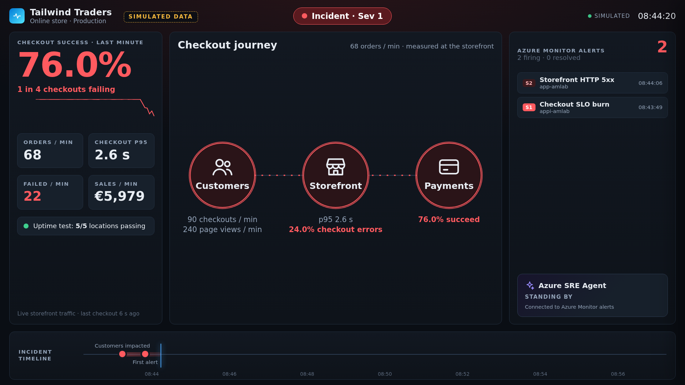
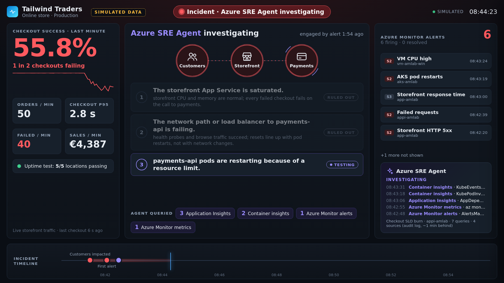
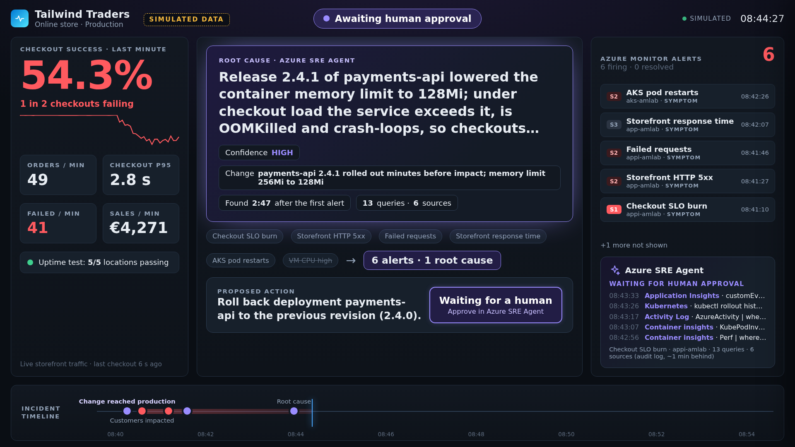
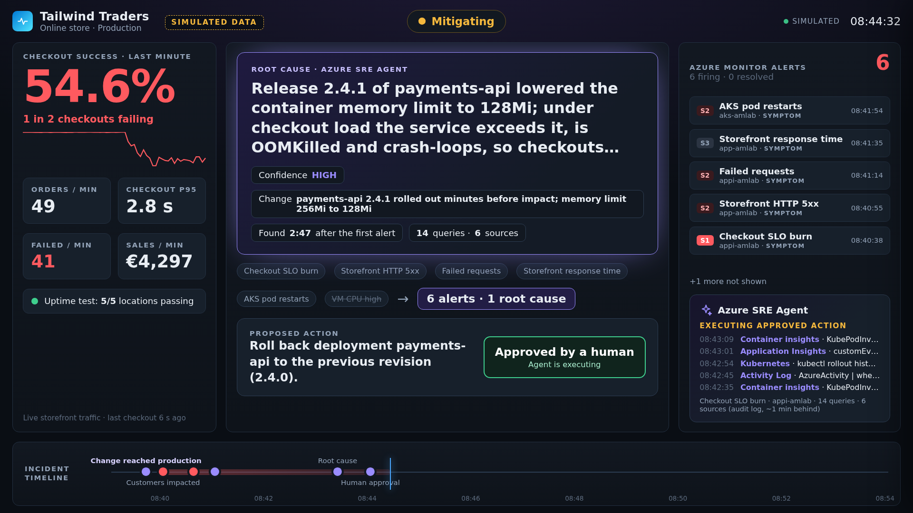
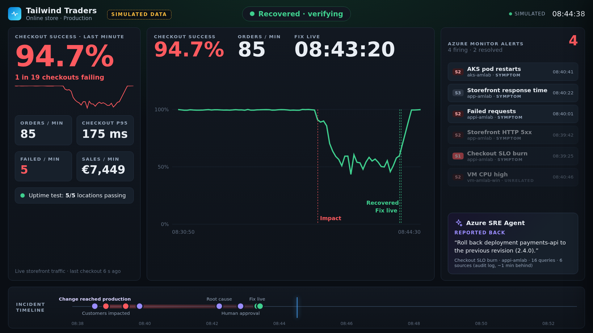
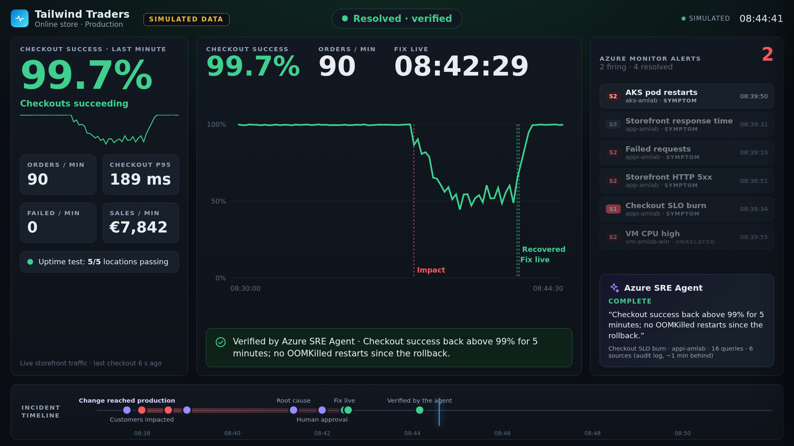
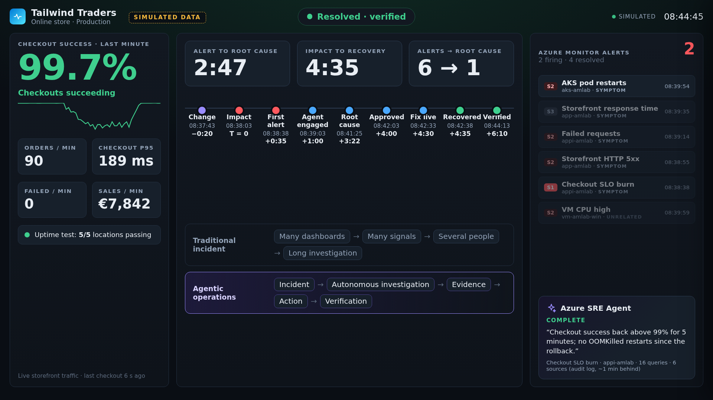
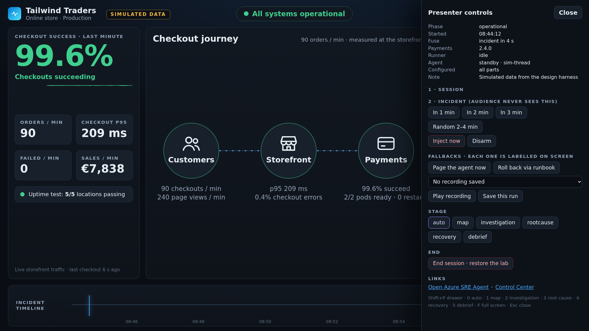

# The Bridge Call That Never Happened

**SRE Mission Control: a live Azure SRE Agent demo built on azure-monitor-lab**

Design v1.2 · 5 November 2026 · Owner: Hendrik Tilleman

> This file is the complete build specification. This repository is a fork of [Azure-Samples/azure-monitor-lab](https://github.com/Azure-Samples/azure-monitor-lab); this file and the `design/` folder with screen previews sit at its root. GitHub Copilot builds everything else, one work item at a time (section 12).

## Contents

- [0. How to use this document](#0-how-to-use-this-document)
- [1. Rules for GitHub Copilot](#1-rules-for-github-copilot)
- [2. The big idea](#2-the-big-idea)
- [3. The mic-drop moment](#3-the-mic-drop-moment)
- [4. Incident design: the rightsizing release](#4-incident-design-the-rightsizing-release)
- [5. Storyboard (18 minutes)](#5-storyboard-18-minutes)
- [6. SRE Mission Control experience](#6-sre-mission-control-experience)
- [7. Architecture](#7-architecture)
- [8. Repository plan](#8-repository-plan)
- [9. Component specifications](#9-component-specifications)
- [10. Presenter runbook](#10-presenter-runbook)
- [11. Audience takeaway](#11-audience-takeaway)
- [12. Work items for GitHub Copilot](#12-work-items-for-github-copilot)
- [13. Build priorities](#13-build-priorities)
- [14. Capability truth table](#14-capability-truth-table)
- [15. Critical review](#15-critical-review)
- [16. Risks and validation items](#16-risks-and-validation-items)
- [Appendix A. Agent reporting format](#appendix-a-agent-reporting-format)
- [Appendix B. Release 2.4.0 versus 2.4.1](#appendix-b-release-240-versus-241)
- [Appendix C. Glossary](#appendix-c-glossary)

## 0. How to use this document

**For people.** In your fork of azure-monitor-lab, add this file and the `design/` folder at the root and enable GitHub Actions (forks start with workflows switched off). Then ask GitHub Copilot: *"Read DESIGN.md and do work item 0."* Continue with work items 1 to 5, one pull request each, then run gate A yourself (section 12). Only when the agent passes it, continue with work items 6 to 9. Nothing else needs to be copied by hand: work item 0 creates the Copilot rules file and the build checks.

**For GitHub Copilot.**

1. Read this whole file before starting any work item.
2. Do the work items in [section 12](#12-work-items-for-github-copilot) in order, one pull request each, and do not start work item 6 before the owner reports that gate A passed. Each work item names the sections that specify it and the checks that define "done".
3. Sections 2 to 7 explain the experience and the reasons behind it. Section 9 is the implementation specification. Section 10 is how the demo is run, which the code must support.
4. The base code is this repository, a fork of [Azure-Samples/azure-monitor-lab](https://github.com/Azure-Samples/azure-monitor-lab) (MIT licence). All new code is written here; do not copy code from anywhere else. Keep changes upstream-friendly so the scenario can be proposed back to the lab later.
5. Facts about the lab were checked against its `main` branch in late October 2026. Where the code in this repository differs from this document (names, paths, APIs), follow the code, keep the intent, and list the difference in the pull request description.
6. You cannot reach the owner's Azure subscription. For every check that needs Azure, write the exact verification commands in the pull request description under **Owner to verify**.
7. Azure SRE Agent facts come from the Microsoft Learn documentation reviewed for this design. Several of its APIs are preview: wrap them, pin their versions and degrade gracefully when they change.

## 1. Rules for GitHub Copilot

Work item 0 copies the block below into `.github/copilot-instructions.md`. If the lab already has that file, append the block under its own heading instead of replacing the file.

```text
# SRE Mission Control: rules for GitHub Copilot
The full specification is DESIGN.md at the repository root. Read the relevant sections before changing anything.

Honesty (never break these)
- Every number, alert, agent message and timestamp on the Mission Control screen comes from a live source: the storefront pulse, Azure Monitor alerts, Container insights, Application Insights availability results, the Azure SRE Agent thread or the agent's audit log.
- Never invent, interpolate, hard-code or smooth agent output, root causes or metrics. A missing value is shown as "not measured".
- Every fallback is labelled on screen: "RECORDED RUN · not live", "Agent paged manually", "Rolled back by runbook · not the agent", and "Simulated data" for the local design harness.
- No typing animations, fake progress bars or spinners that suggest agent activity without data behind it.
- Agent actions are approved only in the Azure SRE Agent portal. Mission Control shows the approval status; it never approves.
- The agent instructions and the knowledge file never contain hints about the injected fault.

Scope and reuse
- This repository is a fork of azure-monitor-lab. Extend it; do not redesign it. Reuse the Control Center web app, the Lab Operations runner, the existing alerts, the AKS workloads and the SRE Agent deployment.
- Keep changes upstream-friendly: follow the lab's conventions, put new files where DESIGN.md section 8 says, avoid unrelated refactors, and never delete or rewrite upstream files beyond the documented edits.
- Mission add-ons are installed on top of a deployed lab by scripts/mission-control.ps1 -Action Setup. Do not change the lab's main Bicep or Terraform deployment unless a work item says so.

Engineering
- One work item per pull request. Small, reviewable changes. Describe what you verified and what the owner must verify in Azure.
- /api/mission/* uses the same operator allowlist, same-origin check and request header as /api/operations. /api/shop/* allows anonymous calls but requires the lab customer key header and has its own rate limit.
- PowerShell 7 scripts are idempotent, safe to run twice, and only touch the lab resource group and the Kubernetes namespace demo. Never delete Azure resources.
- No secrets in the repository. Secrets live in App Service settings and Kubernetes secrets created by the setup script.
- Tests: node --test for the screen's view-model, unit tests for the phase and mark logic, a smoke test for the shop API.
- Keep docs/SRE-MISSION-CONTROL.md up to date with every behaviour change.
```

## 2. The big idea

Every enterprise has lived this hour: a harmless-looking change ships, customers start failing, a dozen alerts fire across three teams and a bridge call fills up with people staring at different dashboards. *The Bridge Call That Never Happened* puts that hour on stage, live, on azure-monitor-lab. The audience first watches the checkout of Tailwind Traders (a fictional online store) running healthy and boring on a big-screen control room called **SRE Mission Control**. Then, without warning or explanation, checkout success starts to fall while the uptime test stays green. Alerts arrive from the storefront, Application Insights and AKS, each telling a different partial story. Azure SRE Agent picks up the incident by itself, forms hypotheses, queries the real telemetry, rules things out and lands on a cause nobody on stage mentioned: a cost-saving release that cut a memory limit. It proposes a rollback and waits; a human approves it, and the room watches real checkout traffic recover before the agent verifies the fix with its own evidence. The last screen shows the measured timeline of the incident: the bridge call that never needed to happen.

## 3. The mic-drop moment

The 45 seconds that should make the room go quiet start when the agent writes its root cause and end when customers are paying again. Nothing in this sequence is animated without data behind it.

| Seconds | On screen | Presenter |
|---|---|---|
| 0–10 | The status pill turns violet: *Root cause identified*. The agent's own root-cause sentence fills the centre, with its confidence and the change it found. | Silent. Let the room read it. |
| 10–20 | The alert rail re-sorts: each alert is tagged SYMPTOM or UNRELATED by the agent and the row collapses into "6 alerts · 1 root cause". On the timeline a violet marker drops in before the first red dot: *Change reached production*. | "It happened before anyone noticed. Nobody on this stage told it about that release." |
| 20–35 | The proposed action appears with a pulsing gate: *Waiting for a human*. The presenter switches to the Azure SRE Agent tab, reads the command aloud and approves it. | "It does not get to change production on its own. I do, with my identity, and it is audited." |
| 35–60 | Back on Mission Control the restarts stop, the checkout line climbs back to 99% and the pill turns green: *Recovered · verifying*. Minutes later the agent posts VERIFIED with its own queries. | "Those are customers paying again. That bridge call never happened." |

Why experienced SREs will respect it: the cause is a change rather than a crash, the agent separates symptoms from cause (including an unrelated VM CPU alert), the approval is a real on-behalf-of approval in the product, and recovery is measured from customer traffic rather than a status flag.

## 4. Incident design: the rightsizing release

### 4.1 Why this incident

| Candidate | In the lab | Verdict |
|---|---|---|
| break-the-lab (VMs deallocated, crash-looping pod, 80% `/api/explode`, annotation) | Exists | Too obvious and multi-cause; the annotation names the culprit. Reuse its mechanics, not its story. |
| CPU stress on the VMs (`simulate-high-cpu`) | Exists | No customer impact. Kept as optional unrelated noise that the agent should dismiss. |
| Error ramp (`loadgen-ramp`, `/api/explode`) | Exists | Synthetic errors on an endpoint called "explode" read as fake to SREs. |
| App Service configuration drift | New | Good second scenario (P1), but one Activity Log entry gives it away too quickly. |
| **FinOps rightsizing release: memory limit 256Mi to 128Mi, OOMKilled under load, CrashLoopBackOff** | New (small) | **Chosen.** A real change through Kubernetes, worsening symptoms, evidence across four sources, change correlation and a safe rollback. |

### 4.2 Incident card

| Aspect | Design |
|---|---|
| Initial trigger | One action: the Mission Control fuse (or the `mission-inject` lab operation) patches deployment `payments-api` to release 2.4.1: version label 2.4.1, memory request 96Mi, limit 128Mi, change-cause "Release 2.4.1 - rightsizing FIN-2291". Rolling update with maxUnavailable 0, plus a normal release annotation, exactly as a pipeline would write it. |
| Customer symptoms | Checkout success starts falling about a minute after the release and keeps getting worse as Kubernetes back-off grows. Checkout p95 rises sharply as retries and timeouts pile up. Orders and sales per minute drop. Browsing is unaffected. The external uptime test (5 locations on "/") stays green. |
| Telemetry generated | Application Insights: storefront requests (`POST /api/shop/checkout` returning 502), dependency calls to payments (timeouts, connection refused or reset), `ShopCheckout` events and the `shop.checkout.failed` metric. Container insights: KubePodInventory (last state OOMKilled, restart counts, version label, new ReplicaSet), container memory working set at the limit, ContainerLogV2 start-up line showing the 128 MiB limit, KubeEvents back-off warnings. Platform metrics: App Service Http5xx and response time. |
| Alerts (expected order) | 1. `alert-checkout-slo-burn` (new, Sev 1). 2. `alert-webapp-5xx` (exists). 3. `alert-appinsights-failed-requests` (exists). 4. `amba-webapp-response-time` (exists). 5. `alert-aks-pod-restart-spike` (exists). 6. Optional noise: `alert-vm-cpu-high` (exists). The availability test stays green. |
| Dependencies | Synthetic customers (k6 job on AKS) call the storefront API on App Service; the storefront calls payments-api on AKS through a LoadBalancer restricted to the web app's outbound IPs (2.5 s timeout, one retry). Telemetry flows to Application Insights and Log Analytics; Azure SRE Agent reads both. |
| Expected investigation path | Quantify impact from requests and dependencies. Hypothesis 1, storefront saturation: ruled out (CPU and memory normal, failures only on payment calls). Hypothesis 2, network or load balancer: ruled out (probes and browsing fine, resets line up with restarts). Hypothesis 3, payments pods restarting on a resource limit: validated (OOMKilled, exit 137, only on the new ReplicaSet). Correlate with the release, classify every alert, state root cause and confidence, propose rollback. The path is not scripted: the agent gets no hint, only a reporting format. |
| Root cause | Release 2.4.1 lowered the payments-api memory limit to 128Mi. Under checkout load the working set exceeds it, the container is OOM-killed, pods crash-loop and checkouts time out. |
| Remediation | The agent proposes `kubectl rollout undo deployment/payments-api -n demo` (through `az aks command invoke`) and requests approval; the presenter approves in the Azure SRE Agent portal. Fallback: the `mission-restore` runbook, labelled on screen. |
| Recovery evidence | The storefront sees payments version 2.4.0 again (fix live), checkout success stays at or above 99% for 45 s (recovered), restarts stop, alerts auto-resolve, the agent writes VERIFIED after its own three-minute check, and the debrief shows the measured timeline. |

### 4.3 Guardrails for the incident

- **Worsening, not binary.** CrashLoopBackOff back-off makes failures ramp over minutes, which builds tension and avoids an instant red screen.
- **No breadcrumbs.** The agent instructions define only a reporting format and safety rules; the knowledge file describes topology, SLOs and owners, never the fault.
- **Safe blast radius.** Only namespace `demo` and only `payments-api`; rollback is a standard kubectl operation and Baseline converges to 2.4.0 from any state.
- **Deterministic enough.** The memory limit is exceeded reliably at a constant arrival rate. The variance comes from alert evaluation and the agent, and the storyboard absorbs it.

## 5. Storyboard (18 minutes)

Times are design targets. On the day every timestamp on screen is measured, never typed in.

#### Act 1: Normal (0:00–2:00)
- **Audience sees:** green pill "All systems operational", about 99.6% checkout success, live flow Customers → Storefront → Payments, 0 alerts, agent standing by.
- **Presenter says:** "This is Tailwind Traders' checkout on Azure. Everything you will see is live. I am not going to tell you what happens next."
- **Technically:** the customers job has run for at least 10 minutes; the fuse was armed before going on stage.
- **Azure SRE Agent:** idle. Response plan `mission-checkout` listens to Azure Monitor alerts.
- **Expected:** a calm baseline that earns credibility.
- **If it fails:** no traffic: run Baseline from the drawer and use the two minutes for the architecture.

#### Act 2: Something is wrong (2:00–4:00)
- **Audience sees:** checkout success starts sliding, with plain words such as "1 in 4 checkouts failing"; p95 rises; overlay "Checkout is failing". The uptime test is still 5/5 green.
- **Presenter says:** "Look at what the board says: uptime is green. Customers cannot pay."
- **Technically:** the fuse fires `mission-inject`: release 2.4.1 rolls out and the new pods run out of memory under load.
- **Azure SRE Agent:** nothing yet; no alert has fired.
- **Expected:** tension: impact without a cause.
- **If it fails:** runner slow: press "Inject now" and keep narrating the business view.

#### Act 3: Signal explosion (4:00–6:00)
- **Audience sees:** alerts land one by one: SLO burn (Sev 1), 5xx, failed requests, response time, pod restarts, VM CPU. Pill "Incident · Sev 1". Optional 20-second cut to the Azure Portal alerts view.
- **Presenter says:** "Normally the bridge call starts now: storefront, platform, payments. Each team has its own dashboard and its own theory."
- **Technically:** Azure Monitor evaluates every minute, plus processing delay.
- **Azure SRE Agent:** picks up the Sev 1 alert that matches the response plan and opens an incident thread.
- **Expected:** a visible storm of partial stories.
- **If it fails:** no thread 2 minutes after the alert: "Page the agent" (the screen shows "Agent paged manually").

#### Act 4: The agent takes over (6:00–8:30)
- **Audience sees:** overlay "Investigation started · engaged automatically by the alert". The centre switches to the investigation board; the impact line appears.
- **Presenter says:** "Nobody paged it; the alert did. It starts where a good SRE starts: what is the customer impact?"
- **Technically:** Mission Control reads the thread every 3 seconds.
- **Azure SRE Agent:** quantifies impact from Application Insights and opens hypothesis 1.
- **Expected:** the agent is visibly working.
- **If it fails:** slow: narrate the query trail and open the thread side by side. No output after 6 minutes: play the recorded run (amber "RECORDED RUN · not live").

#### Act 5: Follow the evidence (8:30–11:00)
- **Audience sees:** hypothesis rows: storefront ruled out, network ruled out, payments testing. "Agent queried" chips by source; the scan ring moves from Storefront to Payments.
- **Presenter says:** "Watch what it rules out. That is the hour a bridge call burns."
- **Technically:** the query trail comes from the agent's audit log, about 1 minute behind, and is labelled as such.
- **Azure SRE Agent:** queries pod inventory, events, logs, memory and rollout history; validates hypothesis 3.
- **Expected:** the search space visibly narrows.
- **If it fails:** the agent ignores the format: the screen shows its latest text verbatim; read along in the portal.

#### Act 6: Root cause (11:00–12:30)
- **Audience sees:** the root-cause card in the agent's words, its confidence and the change; alerts collapse to "6 alerts · 1 root cause"; the change marker drops onto the timeline before the impact.
- **Presenter says:** silence. Then: "A cost-saving release, minutes before anyone noticed."
- **Technically:** the phase changes on the first ROOT CAUSE line.
- **Azure SRE Agent:** writes root cause, confidence, alert verdicts and the proposed action.
- **Expected:** the room goes quiet.
- **If it fails:** the agent stops at a symptom: type a follow-up in the thread, visibly: "What changed before the restarts started?"

#### Act 7: Recovery (12:30–14:30)
- **Audience sees:** gate "Waiting for a human"; the presenter approves in the SRE Agent portal; the gate turns "Approved by a human"; then "Fix live hh:mm:ss".
- **Presenter says:** "It proposes, I approve. Review mode, my identity, fully audited."
- **Technically:** on-behalf-of approval, then `az aks command invoke` runs the rollback (duration measured in rehearsal).
- **Azure SRE Agent:** executes the approved action and checks the rollout.
- **Expected:** the fix reaches production.
- **If it fails:** approval fails or takes over 2 minutes: "Roll back via runbook" (screen: "Rolled back by runbook · not the agent").

#### Act 8: Proof (14:30–16:30)
- **Audience sees:** the recovery view: the success line climbs back to 99% with Impact, Fix live and Recovered markers; alerts resolve; the VERIFIED box shows the agent's words.
- **Presenter says:** "Not a status flag: customers paying again."
- **Technically:** Recovered after 45 seconds at 99% or better; alerts auto-mitigate.
- **Azure SRE Agent:** re-queries the original signals for three minutes, writes VERIFIED and a LEARNING.
- **Expected:** proof.
- **If it fails:** no verification: ask "Verify the recovery with data" in the thread; the measured recovery is on screen anyway.

#### Act 9: Mic drop (16:30–18:00)
- **Audience sees:** the debrief: alert to root cause, impact to recovery, "6 → 1"; the measured steps; Traditional versus Agentic operations.
- **Presenter says:** the closing lines (section 11).
- **Technically:** the presenter presses D.
- **Expected:** "How do I deploy this?"
- **If it fails:** a missing mark shows "not reached"; never fill it in by hand.

**Timing reality.** Three intervals are outside the presenter's control: metric ingestion before the first alert, the agent's investigation time and the approval-plus-rollback round trip. Measure all three in the dress rehearsal and set the fallback triggers from those numbers. If the agent is faster than the plan, shorten the Act 5 narration; if it is slower, use the Act 4–5 contingencies. When verification runs long, open the debrief once customers have recovered and come back to the agent's VERIFIED line during questions.

## 6. SRE Mission Control experience

SRE Mission Control is a new big-screen mode of the existing Control Center (`/mission.html`). It is a lens on live data, not a second platform: if it fails, the demo continues in the Azure Portal and the Azure SRE Agent portal.

### 6.1 Principles

- **One focus point per phase.** The centre stage changes with the incident; everything else recedes.
- **Business first.** The left rail always speaks in customer terms ("1 in 2 checkouts failing"), never in pod names.
- **Evidence over animation.** Every element is backed by a live source and shows its delay; a missing value reads "not measured", never a placeholder.
- **Honest labels.** "Simulated data", "RECORDED RUN · not live", "Agent paged manually", "Rolled back by runbook · not the agent" and "audit log, about 1 min behind" are always shown when they apply.
- **Azure visual language in dark mode.** Near-black canvas, Azure blue for traffic, status colours only for status, violet only for the agent, Segoe UI. The headline figure is about 95 px tall on a 1080p screen so the back row can read it.
- **Engineering controls are invisible.** A presenter drawer opens with Shift+P, or lives on a second screen with `?view=presenter`.

### 6.2 Layout

```text
+--------------------------------------------------------------------------------+
| [logo] Tailwind Traders          ( * status pill * )          LIVE   15:24:57  |
+----------------+----------------------------------------------+----------------+
| BUSINESS       | CENTRE STAGE (one focus per phase)           | SIGNALS        |
| Checkout       |   map > investigation > root cause >         | Azure Monitor  |
| success 99.6%  |   recovery > debrief                         | alerts (count) |
| plain words    |                                              |  - alert rows  |
| 10-min line    |                                              |                |
| orders / min   |                                              | Azure SRE      |
| p95 · failed   |                                              | Agent card     |
| sales / min    |                                              | (state, latest |
| uptime test    |                                              |  finding,      |
| last checkout  |                                              |  query trail)  |
+----------------+----------------------------------------------+----------------+
| INCIDENT TIMELINE   o impact  o first alert  o engaged  o root cause  ... | now |
+--------------------------------------------------------------------------------+
```

| Zone | Content | Source and refresh |
|---|---|---|
| Top bar | Brand, status pill (one per phase), freshness (Live, Reconnecting, Connection lost), clock. | Mission session phase, every 2 s. |
| Left rail: business | Checkout success over the last minute, a plain-words line, a 10-minute line, orders per minute, checkout p95, failed per minute, sales per minute, uptime test, time of the last checkout. | Storefront pulse in the web app (real time); availability results (60 s). |
| Centre stage | Service map, then investigation board, root cause, recovery and debrief. | Per phase; the presenter can override with keys 0–5 and D. |
| Right rail: signals | Azure Monitor alerts (severity, title, resource, time, the agent's verdict) and the agent card (state, latest finding, last five queries). | Alerts API (15 s cache); agent thread (3 s); agent audit log (about 1 min). |
| Bottom | Incident timeline with measured marks. The release marker appears only after the agent names the cause. | Session marks, every 2 s. |

### 6.3 States and transitions

| Phase | Trigger (measured) | Status pill | Centre stage |
|---|---|---|---|
| standby | No mission session. | Standing by | Service map |
| operational / armed | Session started; armed means the fuse is set and looks identical on screen. | All systems operational | Service map |
| impact | Storefront checkout success below 97% over the last 20 s (at least 15 attempts). | Customer impact · checkout | Service map, nodes turn red; overlay |
| alerting | First Azure Monitor alert fired after the session start. | Incident · Sev 1 | Service map; the alert rail fills |
| investigating | Agent thread created after the first alert (or paged by the presenter). | Incident · Azure SRE Agent investigating | Investigation board |
| root-cause | First ROOT CAUSE line in the thread. | Root cause identified | Root-cause card, alert collapse |
| awaiting-approval | Approval request in the thread. | Awaiting human approval | Root cause with pulsing gate |
| mitigating | Approval granted, runbook started or new payments version observed. | Mitigating | Root cause, gate approved |
| recovered | Checkout success at or above 99% for 45 s after the fix. | Recovered · verifying | Recovery chart |
| verified | First VERIFIED line from the agent. | Resolved · verified | Recovery; D opens the debrief |
| ended | Presenter ends the session. | Session ended | Service map |

The exact rules for each mark are in [9.7](#97-mission-control-backend).

### 6.4 Centre stages

- **Service map.** Three nodes, Customers → Storefront → Payments, connected by flowing dots whose speed follows the request rate and whose colour follows the state (Azure blue healthy, amber degraded, red critical, grey unknown). Each node shows two live metrics: checkouts and page views per minute; storefront p95 and checkout error rate; payment success rate. Payments pod readiness and restarts appear only from the investigating phase onward (or in the presenter view), so the audience discovers the cause with the agent. After the root cause, Payments is tagged ROOT CAUSE and the other degraded nodes SYMPTOM.
- **Investigation board.** A small service map with a violet scan ring on the node the agent queried most recently (from its audit log, shown only if that query is under 150 s old). Below it, one row per hypothesis: number, statement, evidence and a chip (Testing, Confirmed, Ruled out, Inconclusive); show the newest five, always keeping the confirmed one. If the agent has not used the format yet, show its latest text verbatim with its timestamp. At the bottom, "Agent queried" chips count the agent's queries per data source.
- **Root cause.** A card with the agent's root-cause sentence, its confidence, the change it found, "found m:ss after the first alert" and "n queries · m sources". Below it, the alert collapse: each fired alert as a pill with the agent's verdict, then "N alerts · 1 root cause". Then the proposed action with the approval gate: *Waiting for a human* (pulsing), *Approved by a human*, or *Rolled back by runbook · Presenter fallback · not the agent*.
- **Recovery.** Three large numbers (checkout success, orders per minute, time the fix went live) above a 30-minute checkout success chart (0 to 100%) with Impact, Fix live and Recovered markers. When the agent writes VERIFIED, a green box shows its words with "Verified by Azure SRE Agent".
- **Debrief.** Three headline numbers: alert to root cause, impact to recovery, and alerts fired against the single root cause (for example "6 → 1", shown only once the agent has stated a root cause). Then the measured steps (Change, Impact, First alert, Agent engaged, Root cause, Approved, Fix live, Recovered, Verified) with clock time and offset from the impact. Then two lanes: *Traditional incident: many dashboards → many signals → several people → long investigation* and *Agentic operations: incident → autonomous investigation → evidence → action → verification*.

### 6.5 Moments

A centred overlay appears for about 5.5 seconds on each forward phase change, only when the stage is on automatic:

| Phase reached | Kicker | Headline | Detail |
|---|---|---|---|
| impact | Customer impact | Checkout is failing | Plain words, for example "1 in 4 checkouts failing" |
| alerting | Azure Monitor | Incident · Sev n | Title of the first alert |
| investigating | Azure SRE Agent | Investigation started | "Engaged automatically by the alert" or "Paged by the presenter" |
| root-cause | Azure SRE Agent | Root cause identified | Confidence, if stated |
| awaiting-approval | Human in the loop | Approval requested | "The agent proposes a fix and waits for a person" |
| recovered | Customers | Checkout recovered | Current success rate |
| verified | Azure SRE Agent | Recovery verified | – |

### 6.6 Visual language

| Token | Value | Use |
|---|---|---|
| Canvas | #0A0E14, with a soft radial glow that tints red during impact, violet during root cause and green after recovery | Background |
| Panel | #121821 to #0E131A, border #233041, radius 14 px | Rails and stage |
| Text / dim / faint | #E8EDF3 / #93A3B8 / #5D6B7E | Text hierarchy |
| Azure | #4AA8FF (deep #0078D4) | Traffic, links, "now" line |
| Good / warn / bad | #3FCF8E / #F5B83D / #FF5A5F | Status only |
| Agent | #9A8CFF | Everything the agent did |
| Font | Segoe UI Variable, Segoe UI, system UI; tabular numbers for figures | All text |
| Scale | Root font clamp(13 px, 0.95 vw, 26 px); headline KPI about 5.2 rem | Readable from the back row at 1920×1080 |
| Motion | Short fades and entries only; honour prefers-reduced-motion | – |

### 6.7 Presenter controls

| Control | What it does | Visible to the audience |
|---|---|---|
| Start session | Typed resource group plus consent; runs Baseline (payments 2.4.0, default noisy traffic paused, customers started). Optional noise toggle. | No |
| Fuse: 1, 2, 3 min or random 2–4 min | Server-side timer that injects the release; survives a page refresh. Disarm is available. | No |
| Inject now | Immediate release 2.4.1. | No |
| Page the agent | Creates an incident thread with an incident brief when the alert path is late. | Yes: "Agent paged manually" |
| Roll back via runbook | `mission-restore` if the approval path fails. | Yes: "Rolled back by runbook · not the agent" |
| Save this run / Play recording | Captures a real thread for later; replays it as a fallback. | Yes: amber "RECORDED RUN · not live" |
| Stage keys | 0 auto, 1 map, 2 investigation, 3 root cause, 4 recovery, 5 or D debrief, F full screen, Esc close. | Only the stage change |
| End session | Stops customers, restores payments, resumes default lab traffic. | Pill "Session ended" |

### 6.8 Screen previews

These previews show the target look. They come from a design harness fed with simulated, watermarked data; the agent text in them illustrates the reporting format and is not agent output. Build the screen from the specification in 6.1 to 6.7 and 9.8, using these as the visual reference.


*Act 1 · All systems operational: business rail, live service map, no alerts, agent standing by.*


*Act 2 · Customer impact: checkout success falling while the uptime test stays green; no alert has fired yet.*


*Act 3 · Signal explosion: the first alerts land and the incident turns Sev 1.*


*Acts 4–5 · Investigation board: hypotheses ruled out and testing, sources the agent queried, its query trail.*


*Act 6 · Root cause: the agent's finding, alert verdicts collapsing to one cause, the proposed action waiting for a human.*


*Act 7 · Approved by a human; the agent is executing the rollback.*


*Act 8 · Recovery measured from checkout traffic, with Impact, Fix live and Recovered markers.*


*Act 8 · Verified by the agent, in its own words.*


*Act 9 · Debrief: measured durations, the incident steps and the operational comparison.*


*Presenter drawer (Shift+P or `?view=presenter`): session, fuse, labelled fallbacks, stage override, end.*

## 7. Architecture

### 7.1 End-to-end flow

1. Synthetic customers (k6 job on AKS, constant arrival rate, web, mobile and partner channels) call `POST /api/shop/checkout` on the Control Center App Service.
2. The storefront API (inside the Control Center web app) calls payments-api on AKS with a 2.5 s timeout and one retry, records every checkout in an in-process pulse (1-second buckets, 30 minutes) and emits Application Insights telemetry: requests, dependencies, a `ShopCheckout` event and the `shop.checkout.failed` metric.
3. Azure Monitor evaluates the existing lab alert rules and the new checkout SLO alert; Container insights sends pod inventory, events, logs and memory to Log Analytics; the availability test keeps probing "/".
4. Azure SRE Agent: response plan `mission-checkout` (Sev 1, title contains "checkout", Review mode) opens a thread, runs a hypothesis-driven investigation over Application Insights, Log Analytics, metrics, alerts and the Azure CLI, proposes an action, waits for on-behalf-of approval, runs the rollback with `az aks command invoke` and verifies. Every tool call lands in its audit log in Application Insights.
5. The Mission Control backend (`/api/mission/*`) combines the pulse, alerts, pod inventory, uptime, the agent thread and the audit log, derives phase and marks, and persists the session under `/home/data` so a restart does not lose the show.
6. The Mission Control screen polls `/api/mission/snapshot` every 2 s. Presenter actions post to `/api/mission/*`, which dispatches the existing Lab Operations runner (Container Apps job) for Baseline, Inject, Restore and End.
7. Verification uses three independent signals: the `X-Payments-Version` header seen by the storefront (fix live), the pulse (recovered) and the agent's own VERIFIED line (verified).

### 7.2 Data sources and delays

| Source | Used for | Typical delay | How the screen shows it |
|---|---|---|---|
| Storefront pulse (in the web app) | Business rail, impact and recovery marks, fix observed | Real time | "Live storefront traffic · last checkout n s ago" |
| Azure Monitor alerts (Alerts Management API) | Alert rail, first alert mark | Rule evaluation plus about 15 s cache | Fired time per alert |
| Container insights (KubePodInventory) | Pods ready and restarts on the payments node | About 1–3 min ingestion | Shown from the investigation phase on |
| Availability results | Uptime chip | Test frequency | "Uptime test n/5 locations passing" |
| Azure SRE Agent data plane | Thread, findings, approval status | 3 s polling | Agent state and quotes with timestamps |
| Agent audit log (Application Insights custom events) | Sources queried, scan ring, query trail | About 1 min | "audit log, about 1 min behind" |

### 7.3 Identity and permissions

| Identity | Needs | Status |
|---|---|---|
| Control Center managed identity | Monitoring Reader and Log Analytics Reader on the lab resource group; SRE Agent Reader on the agent (read threads); optional SRE Agent Standard User (page the agent). | Extend: role grants in the setup script |
| Lab Operations runner identity | Existing AKS and resource-group rights; mission operations add checks for patch deployments, patch cronjobs, delete jobs and get pods in namespace `demo`. | Exists, small extension |
| Azure SRE Agent | Low access level (reader roles). Writes only through an approved on-behalf-of action. | Exists |
| Presenter | Control Center operator allowlist; SRE Agent Administrator to approve; rights on the AKS cluster for the approved action. | Exists; verify per presenter |

## 8. Repository plan

### 8.1 The base: azure-monitor-lab

This repository is a fork of [Azure-Samples/azure-monitor-lab](https://github.com/Azure-Samples/azure-monitor-lab) (branch `main`, MIT licence). The mission work extends it in place. Sync the fork with upstream (GitHub's "Sync fork") before starting a work item, so changes land on current lab code. The lab deploys with Bicep or Terraform (one-shot `scripts/deploy.ps1` with `lab.config.json`, a portal button, or staged); the Azure SRE Agent is an optional stage (`infra/stages/60-sre-agent.bicep`). Mission add-ons are installed afterwards by `scripts/mission-control.ps1 -Action Setup`, so they work with either deployment path.

What matters in the lab for this work (checked against `main` in late October 2026; confirm in the code):

| Area | Where | Role in this demo |
|---|---|---|
| Control Center | `workloads/webapp` (.NET 8 App Service, `Program.cs`, `LabOperationCatalog.cs`, `LabOperationsService.cs`, `frontend/` vanilla JavaScript bundled by esbuild through `frontend/build.mjs` into `wwwroot/console.js`, `wwwroot/index.html`) | Hosts the storefront API, the Mission Control backend and the big screen. `Program.cs` already protects `/api/operations` with an operator allowlist (Easy Auth principal when hosted, loopback locally), a same-origin check and a request header for POSTs, plus named rate limiters. |
| Lab Operations runner | Container Apps job; image built by ACR Tasks from the file list in `scripts/initialize-webapp-console.ps1`; operations run through `scripts/invoke-lab-operation.ps1`; journal under `/home/data/lab-operations` | Runs Baseline, Inject, Restore and End. One active run at a time. |
| Fault scripts | `scripts/break-the-lab.ps1`, `scripts/restore-the-lab.ps1`, `scripts/simulate-high-cpu.ps1`, the release annotation operation | Patterns to reuse; CPU simulation is optional noise. |
| AKS workloads | `workloads/k8s/01`–`05` in namespace `demo`: hello-frontend, the loadgen CronJob (every minute, about 15% calls to `/api/explode`), loadgen-ramp, otel-caller (about 10% errors), a Node.js OpenTelemetry sample | The default traffic keeps 5xx and failed-request alerts firing on purpose; Baseline pauses it during a show and End resumes it. |
| Alerts | `infra/modules/alerts.bicep` and AMBA: `alert-webapp-5xx`, `alert-appinsights-failed-requests`, `alert-aks-pod-restart-spike`, `alert-aks-node-cpu-high`, `alert-vm-cpu-high`, `amba-webapp-response-time` and others; an availability test on "/" from 5 locations; a health model | They become the signal storm. |
| Azure SRE Agent | Agent resource (preview API) in Review mode, low access level, connectors to Application Insights, Log Analytics and Azure Monitor; response plans `amlab-app-alerts` and `amlab-platform-alerts` | The hero. Mission adds one response plan and one custom agent. |
| Docs | `README.md`, `docs/DEMO-SCENARIOS.md`, `docs/STAGE-SRE-AGENT.md`, `docs/LAB-CONTROL-CENTER.md`, `docs/POST-DEPLOYMENT.md` | Extended with a new scenario and a Mission Control guide. |

Default names: resource group `rg-azure-monitor-lab`; Kubernetes namespace `demo`. Discover the other names (web app, AKS cluster, Application Insights, Log Analytics workspace, action group, agent) at run time instead of hard-coding them.

### 8.2 Exists, extend, build

| Piece | Status | What exactly |
|---|---|---|
| Lab deployment: resource group, App Service, AKS, VMs, Log Analytics, Application Insights, Container insights | Exists | Reuse as deployed. |
| Control Center web app | Extend | Add the Mission Control mode (`/mission.html`, `/api/mission/*`) and the storefront API (`/api/shop/*`). |
| Lab Operations runner and journal | Extend | Five mission operations; one session-level consent replaces the per-operation dialog during the show. |
| `invoke-lab-operation.ps1` and `initialize-webapp-console.ps1` | Extend | Allow the mission operations; add the mission script and manifests to the runner image. |
| break-the-lab and restore-the-lab | Exists | Not the hero incident; their kubectl and annotation patterns are reused. |
| CPU simulation and release annotation | Exists | Optional unrelated noise; the release marker for payments-api 2.4.1. |
| Default traffic: loadgen CronJob, otel-caller, loadgen-ramp | Exists | Paused during the show, resumed by End. |
| Alert rules, availability test, health model | Exists | The signal storm; uptime stays green (the "board versus business" moment). |
| Checkout SLO burn alert | Build | `infra/modules/mission-alerts.bicep`, deployed by Setup. |
| Azure SRE Agent resource, connectors and response plans | Extend | Add response plan `mission-checkout` and custom agent `mission-sre`; switch the lab response plans off during the show. |
| payments-api workload | Build | Manifests 06 (2.4.0), 08 (release 2.4.1), 09 (back to 2.4.0). |
| Synthetic customers | Build | Manifest 07: k6 job. |
| Storefront API and business pulse | Build | Checkout and catalog endpoints, in-process pulse, Application Insights telemetry. |
| Mission Control backend and screen | Build | Session, fuse, phase and marks, snapshot API, agent feed, recording and replay; the big screen and its design harness. |
| Scripts | Build | `mission-control.ps1`, `mission-preflight.ps1`, `setup-mission-sre-agent.ps1`. |
| Documentation | Extend / build | `docs/SRE-MISSION-CONTROL.md`, a new scenario in `docs/DEMO-SCENARIOS.md`, a README link. |

### 8.3 Files to modify

| File | Change | Done when |
|---|---|---|
| `workloads/webapp/Program.cs` | Register the mission services; add a `mission-reads` rate limiter; add `/api/mission` to the protected-paths middleware and owner capture exactly like `/api/operations`; map the shop and mission endpoints. `/api/shop` stays outside operator auth but requires the customer key header and has its own limiter. | Operators get `/api/mission/snapshot`; others get 401 or 403; k6 traffic reaches `/api/shop`. |
| `workloads/webapp/LabOperationCatalog.cs` | Add `mission-baseline`, `mission-inject`, `mission-inject-noise`, `mission-restore`, `mission-end`. | They appear in the Lab Operations tab. |
| `workloads/webapp/LabOperationsService.cs` | Add a typed internal dispatch for mission operations (used only inside a consented mission session) and a way to read a run's latest state; keep the journal and the one-run-at-a-time rule. | Mission Control can start and follow a run without the per-operation dialog. |
| `scripts/invoke-lab-operation.ps1` | Allow the five operations; map them to `mission-control.ps1` actions; add the Kubernetes permission pre-checks; keep all existing guards. | Each operation runs in the runner image. |
| `scripts/initialize-webapp-console.ps1` | Add `scripts/mission-control.ps1` and `workloads/k8s/07`, `08`, `09` to the runner image file list. | The runner image contains the files. |
| `workloads/webapp/frontend/build.mjs` and `package.json` | Second entry point for the mission screen (output `wwwroot/mission.js`); scripts `test:mission` and `dev:mission`. | `npm run build` emits both bundles. |
| `workloads/webapp/wwwroot/index.html` | A "Mission Control" link in the navigation. | The link opens `/mission.html`. |
| App Service configuration | Mission settings (9.7); if App Service authentication requires sign-in site-wide, exclude `/api/shop/*`. | Settings present; anonymous shop calls are not redirected to sign-in. |
| `docs/DEMO-SCENARIOS.md`, `README.md` | New scenario and reset steps; link to `docs/SRE-MISSION-CONTROL.md` and `DESIGN.md`. | A colleague can run the demo from the docs alone. |

### 8.4 New files

| Path | Purpose |
|---|---|
| `.github/copilot-instructions.md` | Copilot rules (work item 0). |
| `.github/workflows/copilot-setup-steps.yml` | Tools for Copilot's cloud environment (work item 0). |
| `.github/workflows/mission-ci.yml` | Build and test checks on every pull request (work item 0). |
| `docs/mission/agent-trials.md` | Gate A procedure and trial log (work item 5). |
| `workloads/k8s/06-payments-api.yaml` | payments-api 2.4.0: code, deployment, LoadBalancer service (9.1). |
| `workloads/k8s/07-mission-customers.yaml` | k6 synthetic customers job (9.2). |
| `workloads/k8s/08-payments-api-release-2.4.1.yaml` | The release that causes the incident (9.1). |
| `workloads/k8s/09-payments-api-baseline-2.4.0.yaml` | Converge back to the healthy baseline (9.1). |
| `workloads/webapp/MissionControl/` | Storefront API, pulse, Azure clients, signals, agent feed, session coordinator, endpoints (9.3, 9.7). |
| `workloads/webapp/wwwroot/mission.html`, `mission.css` | The big screen (9.8). |
| `workloads/webapp/frontend/mission-control.js`, `mission-model.js` | Rendering and the pure view-model (9.8). |
| `workloads/webapp/frontend/dev/mission-dev-server.mjs` | Local design harness with simulated, watermarked data (9.8). |
| `workloads/webapp/frontend/tests/` and a .NET test project | View-model tests; phase, mark and shop tests (9.7, 9.8). |
| `scripts/mission-control.ps1` | Setup, Baseline, Inject, Restore, End, Status (9.5). |
| `scripts/mission-preflight.ps1` | GO / NO-GO checks (9.9). |
| `scripts/setup-mission-sre-agent.ps1` | Custom agent, response plan guidance, role checks (9.6). |
| `infra/modules/mission-alerts.bicep` | Checkout SLO burn alert (9.4). |
| `workloads/mission/agent/mission-sre.instructions.md` | Agent reporting format and safety rules (9.6). |
| `workloads/mission/knowledge/tailwind-traders-service-map.md` | Topology, SLOs and owners for the agent (9.6). |
| `docs/SRE-MISSION-CONTROL.md` | Setup, run of show, fallbacks, reset, capability truth table (9.10). |

## 9. Component specifications

### 9.1 payments-api

**Purpose.** A small, believable payment authorisation service on AKS whose memory use under checkout load sits between 128 MiB and 256 MiB, so release 2.4.1 fails only under real traffic.

**Behaviour**

- Python 3.11 standard library only, shipped in a ConfigMap and run on the public `python:3.11-slim` image, so no image build is needed.
- `POST /v1/authorize` with `amount`, `currency` and `channel` returns an authorisation id and `approved` or `declined` (about 1% declined; a decline is a normal business outcome, not a failure).
- `GET /healthz` (process alive) and `GET /readyz` (reference data loaded).
- Every response carries `X-Payments-Version` with the running version. Requests must carry the shared `X-Payments-Key` from a Kubernetes secret; others get 401.
- Memory profile (design targets; tune to meet the acceptance checks): about 40 MiB of synthetic reference data (card ranges, risk tables) loaded at start-up, plus a bounded in-memory cache of recent authorisations (about 120 entries of about 1 MiB, oldest evicted). Under the customer load the working set settles well under 256 MiB and passes 128 MiB within about a minute.
- JSON log lines on stdout: a start-up line with version, memory limit read from the cgroup, resident memory, reference data size and cache size; a stats line every 15 s with resident memory and cache entries; one line per authorisation (id, outcome, latency). These are the agent's evidence in ContainerLogV2.
- No artificial errors and no "explode" endpoints. The memory limit is the only failure mode.

**Manifests**

- `06-payments-api.yaml`: ConfigMap with the service code; Deployment `payments-api` in namespace `demo` with labels `app=payments-api` and `version=2.4.0`, environment `APP_VERSION=2.4.0`, 2 replicas, rolling update with maxSurge 1 and maxUnavailable 0, memory request 192Mi and limit 256Mi, readiness probe on `/readyz` every 2 s, liveness probe on `/healthz`; Service of type LoadBalancer (port 80 to the container port) with an Azure DNS label and `loadBalancerSourceRanges` limited to the web app's outbound IPs. Setup fills both placeholders.
- `08-payments-api-release-2.4.1.yaml`: a strategic-merge patch that only sets version 2.4.1 (label and `APP_VERSION`), memory request 96Mi, limit 128Mi, and the change-cause annotation "Release 2.4.1 - rightsizing FIN-2291". Nothing else changes.
- `09-payments-api-baseline-2.4.0.yaml`: a patch that converges the deployment back to the 2.4.0 values from any state.

The LoadBalancer is the simplest path from App Service to AKS in this lab; private networking is a later improvement (P2).

### 9.2 Synthetic customers

- `07-mission-customers.yaml`: ConfigMap with a k6 script and a Job template (`grafana/k6` image, job name unique per session, active deadline about 110 minutes, cleaned up 10 minutes after it ends).
- Constant arrival rate: about 90 checkouts per minute (`POST /api/shop/checkout`, random product and quantity) and about 240 catalogue views per minute (`GET /api/shop/catalog`) for about 100 minutes.
- Headers: `X-Amlab-Channel` (web 60%, mobile 30%, partner 10%) and `X-Lab-Customer-Key`.
- No thresholds or abort conditions: the job must keep running through the incident.
- The storefront URL, rates and duration are filled in by the script that starts the job.

### 9.3 Storefront API and business pulse

Implemented in the Control Center web app.

| Endpoint | Behaviour |
|---|---|
| `GET /api/shop/catalog` | Six fictional Tailwind Traders products (SKU, name, price in EUR). Counted as a browse. |
| `POST /api/shop/checkout` | Optional `sku` and `quantity`. Calls payments-api `POST /v1/authorize` with a 2.5 s timeout; one retry after about 150 ms on timeout, connection error or 5xx. Success: 200 with order id, amount, currency and payments version. Failure: 502 with `error: payment_failed` and a reason. |

- Failure reasons start with `payments_`: `payments_timeout`, `payments_connection_refused`, `payments_connection_reset`, `payments_http_<status>`. The screen uses the prefix to attribute failures to payments.
- Access: anonymous (no sign-in), but `X-Lab-Customer-Key` must match the configured key (401 otherwise), with a dedicated rate limiter (for example 1,200 calls per minute).
- Telemetry, using the SDK the web app already uses: request telemetry; dependency telemetry for the payments call; a `ShopCheckout` custom event (outcome confirmed, declined or failed; reason; channel; payments version; amount bucket); a custom metric `shop.checkout.failed` with value 1 for a failed checkout and 0 otherwise, so its average is the failure rate; a checkout duration metric.
- Business pulse, in memory, for the big screen: 1-second buckets kept for 30 minutes with attempts, confirmed, declined, failed, failure reasons, latencies, revenue of confirmed orders and browses. Derived values: success rate ((confirmed + declined) / attempts) over the last 60 s, orders per minute, sales per minute (EUR), browses per minute, p50 and p95 checkout latency, failure rate and reasons, a 30-minute series of 10-second points (attempts, success, p95) and the time of the last checkout.
- Version observations: every `X-Payments-Version` seen, with the first time each version appeared. They drive "change observed" and "fix observed".
- The pulse is per instance and assumes the lab's single App Service instance. Aggregating across instances through Application Insights is a P1 item.

### 9.4 Checkout SLO alert

- `infra/modules/mission-alerts.bicep`, deployed by `mission-control.ps1 -Action Setup` so it works with both lab deployment paths.
- `alert-checkout-slo-burn`: metric alert on the lab Application Insights, custom metric `shop.checkout.failed`, average above 0.05 over 5 minutes, evaluated every minute, severity 1, auto-mitigate on, metric validation skipped (the metric only exists once traffic flows), notifying the lab action group. Its name and description contain "checkout": the response plan filters on that word.
- If metric alerts on the custom metric are not available for the way the web app emits metrics, use a log search alert on the checkout requests' failure ratio over 5 minutes, evaluated every minute (slower because of ingestion delay), and record the choice in the docs.

### 9.5 Mission operations

**Script `scripts/mission-control.ps1`** (PowerShell 7). Parameters: `-Action Setup | Baseline | Inject | Restore | End | Status`, `-ResourceGroup` (default from the lab configuration), `-WebAppName` (discovered if omitted), `-WithNoise`, `-EnableAgentPaging`.

| Action | Where it runs | What it does |
|---|---|---|
| Setup | Locally, once, by the owner (needs rights to assign roles) | Discover the lab resources (web app, AKS, Application Insights, Log Analytics, action group, agent). Generate the customer key and the payments key and store them as App Service settings and a Kubernetes secret. Apply manifest 06 with the DNS label (for example `tailwind-pay-<suffix>`) and the web app's outbound IPs as source ranges; wait for the public IP and build the FQDN. Set the mission app settings (9.7). Deploy `mission-alerts.bicep`. Grant the web app identity Monitoring Reader and Log Analytics Reader on the resource group (if missing) and SRE Agent Reader on the agent; SRE Agent Standard User only with `-EnableAgentPaging`. Print the next step (agent setup). |
| Baseline | Runner (`mission-baseline`) | Converge payments to 2.4.0 (manifest 09) and wait until ready. Suspend the loadgen CronJob, scale otel-caller to 0 (remember the previous count), delete a leftover loadgen-ramp job, undo break-the-lab leftovers in `demo` using the existing restore logic. Start a new customers job and print its name. |
| Inject | Runner (`mission-inject`, `mission-inject-noise`) | Guard: payments 2.4.0 ready and a customers job running, otherwise stop with a clear message. Apply manifest 08. Wait up to 2 minutes for the rollout but never fail because it did not finish (crash-looping pods are the point). Write the release annotation "payments-api 2.4.1" with the lab's annotation mechanism. With noise, start the lab's CPU simulation on the demo VMs for 10 minutes in the background; it can never block or fail the inject. |
| Restore | Runner (`mission-restore`) | If 2.4.1 is running, roll the deployment back; then apply manifest 09 and wait until ready (at most 3 minutes). |
| End | Runner (`mission-end`) | Delete the customers job, run Restore, resume the loadgen CronJob and otel-caller, print a summary. |
| Status | Anywhere | Versions, pod readiness and restarts, jobs, fired alerts. |

Rules: idempotent; namespace `demo` only; never delete Azure resources; each runner action finishes in under 3 minutes; clear one-line progress messages for the journal.

**Runner wiring**

- `LabOperationCatalog.cs`: the five operations with plain descriptions; they require approval like break and restore when started from the Lab Operations tab.
- `invoke-lab-operation.ps1`: allow them, map each to its action, check Kubernetes permissions first (patch deployments, patch cronjobs, delete jobs, get pods in `demo`), keep every existing guard (no resource group or subscription switching).
- `initialize-webapp-console.ps1`: add the mission script and manifests 07, 08 and 09 to the runner image.
- `LabOperationsService.cs`: a typed internal method that Mission Control uses to dispatch mission operations without the per-operation dialog, allowed only inside a session where the operator typed the resource group and gave consent; plus a method to refresh a run's state.

### 9.6 Azure SRE Agent setup

**`workloads/mission/agent/mission-sre.instructions.md`**, the custom agent's instructions, must contain:

- Role: the on-call SRE for Tailwind Traders.
- Method: quantify customer impact first; state explicit hypotheses and test each with data; look for recent changes (deployments, rollouts, configuration) before restarting anything; classify every fired alert as cause, symptom or unrelated.
- Reporting format: the line prefixes in [Appendix A](#appendix-a-agent-reporting-format), each on its own line, written as the work progresses.
- Mitigation rules: no change without approval; the smallest safe, reversible action; prefer undoing the most recent relevant change over restarting or scaling; never delete resources.
- Verification: after an approved action, re-check the original signals for at least 3 minutes (checkout failures below 1%, payment dependency success restored, no new container restarts) before writing VERIFIED and one or two LEARNING lines.
- It must not mention payments memory, rightsizing, releases, OOM or anything else about the injected fault.

**`workloads/mission/knowledge/tailwind-traders-service-map.md`**: the services (customers, storefront on App Service, payments-api on AKS namespace `demo`), dependencies, SLOs (checkout success at least 99% over 5 minutes; checkout p95 under 1.5 s), owners (storefront, payments and platform teams) and where the telemetry lives. No fault information.

**`scripts/setup-mission-sre-agent.ps1`**:

- Create or update the custom agent `mission-sre` with those instructions through the agent's data-plane API (preview); if that fails, print the portal steps instead.
- Print the portal steps for response plan `mission-checkout`: Azure Monitor incidents, severity Sev 1, title contains "checkout", Review mode, handled by `mission-sre` where the product supports it (otherwise the default agent with the same instructions).
- Print the steps to switch off `amlab-app-alerts` and `amlab-platform-alerts` during shows, so other alerts do not open competing threads.
- Optionally upload the knowledge file; check the web app identity's agent role; print the agent's portal URL.

Product reality: response plans, custom agents, knowledge files and the data-plane API are documented, but several are preview. Confirm each step in the portal.

### 9.7 Mission Control backend

**Location.** `workloads/webapp/MissionControl/`, registered from `Program.cs`.

**Configuration** (App Service settings). A missing setting switches the matching part off, and the snapshot says so.

| Setting | Meaning |
|---|---|
| `LabConsole__Mission__Enabled` | Turns the mode on. |
| `LabConsole__Mission__ResourceGroup`, `LabConsole__Mission__SubscriptionId` | The lab scope; the operator must type the resource group to start a session. |
| `LabConsole__Mission__PaymentsBaseUrl`, `LabConsole__Mission__PaymentsKey`, `LabConsole__Mission__CustomerKey` | Storefront to payments, and the shop's customer key. |
| `LabConsole__Mission__AppInsightsResourceId`, `LabConsole__Mission__WorkspaceId`, `LabConsole__Mission__AksName` | Telemetry and cluster. |
| `LabConsole__Mission__SreAgentResourceId`, `LabConsole__Mission__SreAgentPortalUrl` | The agent. |
| `LabConsole__Mission__Brand`, `LabConsole__Mission__Subtitle` | "Tailwind Traders", "Online store · Production". |
| `LabConsole__Mission__StatePath` | Default `/home/data/mission` (session and recordings). |

**Endpoints.** All `/api/mission/*` endpoints sit behind the operator allowlist exactly like `/api/operations`; POSTs also need the same request header and same-origin check. Every state-changing call records the operator.

| Method and path | Body | What it does |
|---|---|---|
| `GET /api/mission/snapshot` | none; `?view=presenter` adds presenter data | Full screen state (contract below). Rate limit about 150 per minute per operator. |
| `POST /api/mission/session/start` | `resourceGroup` (typed), `consent: true`, `startCustomers`, `noise` | Checks the typed resource group and consent, creates the session, dispatches `mission-baseline`. One active session at a time. |
| `POST /api/mission/fuse` | `seconds` 0–1800, or null to disarm | Arms a server-side timer that dispatches `mission-inject` (or `mission-inject-noise`) when it expires. Survives page reloads and app restarts. |
| `POST /api/mission/inject` | none | Same as a fuse of 0 seconds. |
| `POST /api/mission/restore` | none | Dispatches `mission-restore`; the fix is recorded as "runbook". |
| `POST /api/mission/page-agent` | none | Creates an agent thread with an incident brief (business impact numbers and fired alert names, no hypotheses); engagement is recorded as "paged". |
| `POST /api/mission/capture` | none | Saves the current agent thread, footprints and marks as a recording. |
| `GET /api/mission/replays` | none | Lists recordings. |
| `POST /api/mission/replay` | `id` | Plays a recording as the agent lane from now on, labelled as recorded. |
| `POST /api/mission/session/end` | `restoreLab` | Dispatches `mission-end` and closes the session. |

**Session.** Persisted to the state path after every change: id, operator, start time, fuse time and whether it fired, noise, every mark, hero thread id, replay, end time. A background loop every 2 seconds fires the fuse and advances the marks.

**Marks.** All measured, never set by hand.

| Mark | Rule |
|---|---|
| Change observed (time, version) | First time the storefront sees a payments version other than 2.4.0 after the session started. |
| Impact | When trailing 20 s success is below 97% with at least 15 attempts: the first 5-second bucket in the last 90 s with at least 3 attempts and success below 97%. |
| First alert (time, rule) | Earliest Azure Monitor alert fired after the session start (minus 1 minute). |
| Agent engaged (time, how) | Hero thread created ("alert"), or the paged thread created ("paged"). |
| Root cause | Time of the first agent message in the hero thread with a ROOT CAUSE line. |
| Approval requested / approved | First approval request in the hero thread; the moment its status becomes approved. |
| Fix observed (time, how) | Storefront sees 2.4.0 again after a change was observed; "agent" or "runbook". |
| Recovered | After an approval, fix or restore: trailing 45 s success at least 99% with at least 45 attempts, and the first good bucket after the last bad one is at least 45 s old. The mark is that bucket's time. |
| Verified | Time of the first agent message with a VERIFIED line. |

**Phase** is the furthest reached of: ended, verified, recovered, mitigating (approved, fix observed or restore requested), awaiting-approval, root-cause, investigating, alerting, impact, armed (fuse set, not fired), operational; standby when there is no session.

**Hero thread.** A paged thread wins. Otherwise the newest thread created after the first alert (minus 1 minute) whose title mentions checkout; otherwise the newest thread created after the first alert.

**Snapshot contract** (camelCase JSON):

| Field | Content |
|---|---|
| `now`, `simulated` | Server time; `simulated` is true only in the design harness. |
| `brand` | Name and subtitle. |
| `configured` | Flags for mode, shop, agent, alerts, operations and agent paging. |
| `session` | Null, or id, start time, phase, noise, fuse time and state, marks, replay id, end time. |
| `pulse` | Availability, window, attempts, success rate, orders, sales and browses per minute, p50, p95, failure rate and reasons, 30-minute series (time, attempts, success, p95), time of the last checkout. |
| `uptime` | Availability, locations, passing locations, time checked, message. |
| `topology` | Nodes `customers`, `storefront`, `payments` with a state (healthy, degraded, critical or unknown) and live metrics; edges with state and rate per second. Payments metrics include pods, ready pods, restarts and when they were observed. |
| `alerts` | Availability, message, items: id, rule, friendly title, severity, state, condition (fired or resolved), target, target type, fired time, resolved time. |
| `agent` | Availability, status, message, thread (id, title, created, source), messages (id, time, role, type, text, complete, approval with id, title, description and status), current approval, footprints (time, kind, tool, input), whether footprints are available, recorded flag and label, portal URL. |
| `operations` | Latest runner operation, state, submitted time, message. |
| `presenter` | Presenter view only: payments version now, version history, hero thread id, notes. |

**Data sources.** Each has a timeout and a cache, fails on its own (`available: false` with a message) and never breaks the snapshot.

| Source | How | Cache |
|---|---|---|
| Alerts | Alerts Management API for the lab resource group since session start minus 5 minutes (subscription scope filtered by resource group as fallback). Friendly titles: `alert-checkout-slo-burn` "Checkout SLO burn", `alert-webapp-5xx` "Storefront HTTP 5xx", `alert-appinsights-failed-requests` "Failed requests", `amba-webapp-response-time` "Storefront response time", `alert-aks-pod-restart-spike` "AKS pod restarts", `alert-vm-cpu-high` "VM CPU high", `alert-aks-node-cpu-high` "AKS node CPU high". | 15 s |
| Payments pods | Log Analytics `KubePodInventory` for namespace `demo` and payments-api: pods, ready, restarts, last status (for example OOMKilled), version label. | 30 s |
| Uptime | Application Insights availability results for the last 10 minutes, by location. | 60 s |
| Agent thread | Azure SRE Agent data plane: the endpoint is the agent resource's `agentEndpoint` property; Microsoft Entra token for the agent's audience; list threads, read thread messages. Only `*.azuresre.ai` hosts are allowed. Poll every 3 s while a session is active. | 3 s |
| Agent footprints | Application Insights custom events written by the agent (`AgentToolExecution`, `AgentAzCliExecution`, `ApprovalDecision`) for the hero thread; about 1 minute behind. | 20 s |
| Pulse and versions | In process (9.3). | Live |

**Security.** Managed identity only; no secrets in responses; agent text returned as plain text (the screen escapes it); allowlisted outbound hosts.

**Tests.** Unit tests replay a recorded timeline (pulse buckets, alerts, messages) and assert every phase and mark; tests switch off each source and assert the snapshot still works with that source marked unavailable; a test restarts the coordinator from the persisted state.

### 9.8 Mission Control screen

**Files.** `wwwroot/mission.html` and `mission.css`; `frontend/mission-control.js` (rendering, polling, drawer); `frontend/mission-model.js` (pure view-model functions, unit tested); bundled to `wwwroot/mission.js` by `build.mjs`; a link from the Control Center navigation.

**Behaviour**

- Poll the snapshot every 2 s and back off on errors. Freshness indicator: Live (last success under 8 s ago), Reconnecting (under 30 s), Connection lost. Show the clock.
- No flicker: update text and attributes in place; entry animations play only for new items; timeline marks are created once and then moved. Timeline labels never overlap (two label lanes; drop a label rather than overlap).
- The centre stage follows the phase (6.3) unless the presenter overrides it.
- Escape all agent text; never render HTML from the agent.
- Parse the agent's report lines (Appendix A) tolerantly: allow bullets, bold, numbering and dash variations. When the agent has not used the format, show its latest text verbatim with its timestamp.
- Labels: "Simulated data" watermark when `simulated` is true; amber "RECORDED RUN · not live" banner; "Agent paged manually"; "Rolled back by runbook · not the agent"; "audit log, about 1 min behind" next to footprints; "not measured" for missing values; "not reached" for marks in the debrief.
- Gates: 401 shows a sign-in link; 403 says the account is not on the operator list; 404 says Mission Control is not installed.
- Presenter drawer (Shift+P, or always open with `?view=presenter`): start session (typed resource group, consent, noise toggle), fuse buttons (1, 2, 3 minutes, random 2–4 minutes), inject now, disarm, page the agent, roll back via runbook, save and play recordings, stage override, end session, links to the agent portal and the Control Center, keyboard help. Ask for confirmation before inject, restore, page and end.
- Keyboard: Shift+P drawer, 0 auto, 1 map, 2 investigation, 3 root cause, 4 recovery, 5 or D debrief, F full screen, Esc close.
- Accessibility: honour prefers-reduced-motion; text contrast at least 4.5:1.

**Design harness.** `frontend/dev/mission-dev-server.mjs` serves the real page with simulated snapshots: one scene per phase (`?scene=operational`, `impact`, `alerting`, `investigating`, `root-cause`, `mitigating`, `recovered`, `verified`) plus a looping run, and it accepts the presenter POSTs. Every simulated snapshot has `simulated: true`, so the watermark shows. It is never deployed. Run with `npm run dev:mission`.

**Tests.** `node --test` for the parser, status pill, stage selection, timeline and number formatting.

### 9.9 Preflight

`scripts/mission-preflight.ps1` prints a GO / NO-GO table, exits with an error on any NO-GO and finishes in under a minute. Checks: Azure context and resource group; web app running with the mission settings; runner enabled; AKS reachable; payments 2.4.0 ready with no recent restarts; public IP and source ranges match the web app's outbound IPs; customers job running for at least 10 minutes; default noise paused; three test checkouts succeed; `/mission.html` returns 200; the SLO alert exists, is enabled and is not firing; no other lab alert firing; agent data plane reachable (the response plan can only be checked in the portal: WARN with a link); Log Analytics daily cap headroom; demo VMs running if noise is planned.

### 9.10 Documentation

- `docs/SRE-MISSION-CONTROL.md`: what it is, prerequisites, setup (Setup plus agent setup), run of show (section 10), fallbacks, reset, the capability truth table (section 14), troubleshooting.
- `docs/DEMO-SCENARIOS.md`: a new scenario "The Bridge Call That Never Happened" with the story, click-path, killer line and reset, in the style of the existing scenarios.
- `README.md`: a short section linking to the guide and to `DESIGN.md`, worded so it could be proposed upstream as is.

## 10. Presenter runbook

The presenter runs the whole show from one browser window: Mission Control in front, the Azure SRE Agent portal and the Azure Portal alerts view in the next tabs.

### 10.1 Once, the day before

1. Deploy or update the lab from this repository (`scripts/deploy.ps1`, including the SRE Agent stage) and redeploy the Control Center.
2. Run `scripts/mission-control.ps1 -Action Setup`: payments-api, public IP and DNS name, managed identity roles, SLO alert, app settings.
3. Run `scripts/setup-mission-sre-agent.ps1` and complete the printed portal steps: custom agent `mission-sre`, response plan `mission-checkout` (Sev 1, title contains "checkout", Review mode), lab response plans switched off for the event.
4. Full dress rehearsal on the venue network; measure the three uncontrolled intervals (first alert, investigation, approval and rollback). Then "Save this run" as the fallback recording.

### 10.2 T-30 minutes

| Check | How | GO when |
|---|---|---|
| Sign-ins | Control Center (operator), Azure SRE Agent portal (Administrator), Azure Portal. | All three open without prompts. |
| Preflight | `scripts/mission-preflight.ps1` | Every line GO. |
| Session | Drawer: typed resource group and consent, Start session (runs Baseline). | Payments 2.4.0 ready; default noisy traffic paused; customers running. |
| Warm-up | Let the customers run. | At least 10 minutes of traffic before going on stage. |
| Alerts | Mission Control right rail and the Azure Portal. | No lab alert firing. |
| Agent | SRE Agent portal. | `mission-checkout` on, lab plans off, no open rehearsal threads, agent memory reset or disclosed. |
| Fallback | Drawer: recordings list. | At least one recording available. |
| Display | 1920×1080, zoom 100%, full screen (F), notifications off. | Readable from the back row. |
| Tabs | Mission Control, SRE Agent portal, Azure Portal alerts, Control Center. | In that order in one window. |

### 10.3 T-5 minutes

- Mission Control is green: checkout success 99% or better, steady orders per minute, 0 alerts, agent standing by.
- Arm the fuse (2 minutes is a good default; random 2–4 minutes if the presenter wants to be surprised too), close the drawer, start talking.

### 10.4 Live sequence

1. Act 1: introduce the store and the screen; do not mention what will happen.
2. Acts 2–3: let the fuse fire; read the business numbers aloud, point at the green uptime test, let the alerts arrive. Optional 20-second cut to the Azure Portal alerts view.
3. Acts 4–5: the overlay announces the agent; narrate impact, hypotheses ruled out and the sources it queries. If it is slow, switch to the thread in the SRE Agent portal for 30 seconds.
4. Act 6: stop talking when the root cause appears; then one line about the change.
5. Act 7: switch to the SRE Agent tab, read the proposed command, approve, switch back.
6. Act 8: point at the success line and the restarts stopping; wait for VERIFIED.
7. Act 9: press D, deliver the closing lines, leave the debrief on screen for questions.

### 10.5 Talk track

> "Everything you will see is live: real Azure, real telemetry, real agent. I am not going to tell you what happens next."

> "Look at what the board says: uptime is green. Customers cannot pay."

> "Normally the bridge call starts now. Every team has its own dashboard and its own theory."

> "Nobody paged it; the alert did. Watch what it rules out."

> "It proposes, I approve. Review mode, my identity, audited."

> "Not a status flag: customers paying again. That bridge call never happened."

### 10.6 Fallback matrix

| Step | Symptom | Action | Screen label |
|---|---|---|---|
| Inject | Runner slow or failed | "Inject now", or run the script from a terminal | None needed |
| Alert | No alert 5 minutes after impact | Show the business impact and the alert rules in the portal; page the agent | "Agent paged manually" |
| Engagement | Alert fired, no thread after 2 minutes | Page the agent | "Agent paged manually" |
| Investigation | No findings after 6 minutes | Open the thread side by side; after 9 minutes play the recording | "RECORDED RUN · not live" (amber) |
| Root cause | The agent stops at a symptom | Ask a follow-up in the thread, visibly | None: it is live |
| Approval | On-behalf-of approval fails or takes over 2 minutes | Roll back via runbook | "Rolled back by runbook · not the agent" |
| Screen | Mission Control fails | Continue in the Azure Portal and the SRE Agent portal | Not applicable |
| Venue | The network blocks the portals | Recording plus the screen previews, clearly labelled | Recorded |

### 10.7 Reset between sessions

1. Drawer: End session (stops customers, restores payments, resumes default traffic).
2. Wait until the mission alerts show as resolved, or close them in the portal.
3. Close the incident thread; reset or replace the agent's incident memory, or plan to disclose it.
4. Start a new session and run preflight. Plan a 20–30 minute buffer between back-to-back shows; most of it is waiting for alerts to resolve and traffic to settle.

Last resort: the lab's `scripts/restore-the-lab.ps1`, then `scripts/mission-control.ps1 -Action Baseline`.

## 11. Audience takeaway

The debrief stays on screen: three measured numbers (alert to root cause, impact to recovery, and alerts fired against the single root cause) and two lanes. Traditional incident: many dashboards, many signals, several people, a long investigation. Agentic operations: incident, autonomous investigation, evidence, action, verification. No feature list, no invented ROI.

> "A cost-saving change went out a quarter of an hour ago. You saw what customers felt, the alerts every team would have argued about, and an agent that worked the problem like a senior SRE: it checked the obvious, ruled things out with evidence, found the change, proposed the smallest fix and waited for a human. Everything ran on the Azure Monitor signals you already collect. Start with one service, the alerts you already have, and Review mode."

## 12. Work items for GitHub Copilot

Do them in order, one pull request each: work items 0 to 5, then gate A (run by the owner), then work items 6 to 9. Every pull request description lists what was verified and, under **Owner to verify**, the exact commands for checks that need Azure. Work items 6 and 7 can run in parallel once gate A has passed.

### Work item 0: Prepare the fork

- **Goal.** Get this fork ready for Copilot work: rules, tools and automatic checks. No change to how the lab behaves.
- **Rules file.** Create `.github/copilot-instructions.md` from section 1, or append section 1 under its own heading if the lab already has that file.
- **Copilot environment.** Add `.github/workflows/copilot-setup-steps.yml` with a single job named `copilot-setup-steps` that installs the .NET 8 SDK, Node.js LTS, the Bicep CLI and the PowerShell module PSScriptAnalyzer, and runs `npm ci` in `workloads/webapp`, so Copilot can build and test its own changes.
- **Checks on every pull request.** Add `.github/workflows/mission-ci.yml`: `npm ci`, `npm run build` and the node tests (once they exist) in `workloads/webapp`; `dotnet build` and `dotnet test` for the solution; `bicep build` for `infra/modules/mission-*.bicep`; PSScriptAnalyzer on the mission scripts. It needs no Azure secrets.
- **Upstream workflows.** Review the lab's existing workflows. Any that need Azure secrets or deploy to Azure must not fail every pull request in this fork: add a condition that skips them outside the upstream repository, or document how to disable them. Do not delete them.
- **README.** A short section near the top linking to `DESIGN.md`, written so it could be proposed upstream.
- **Done when.** Both workflows pass on the pull request, the rules file exists, and the lab's behaviour is unchanged.
- **Owner to do after merging.** Run "Copilot Setup Steps" once from the Actions tab to confirm it succeeds.

### Work item 1: payments-api

- **Spec.** 9.1, 4.2, Appendix B.
- **Build.** Manifests 06, 08 and 09, and a short load-test helper (for example a temporary k6 job aimed at the service) so the memory behaviour can be checked before the storefront exists.
- **Done when (owner verifies on AKS).** 2.4.0 runs under the customer load for 30 minutes with 0 restarts and its working set stays clearly below 256 MiB; after applying 08 under the same load, pods are OOMKilled (exit code 137) within about 2 minutes and enter CrashLoopBackOff; 09 brings back a healthy 2.4.0; the logs show the memory limit and resident memory.

### Work item 2: Storefront API, pulse and synthetic customers

- **Spec.** 9.2, 9.3, 8.3 (`Program.cs`).
- **Build.** The shop endpoints, the payments client, telemetry, the pulse with version observations, manifest 07, and tests (pulse arithmetic, failure reasons, the customer key check).
- **Done when.** With the customers job running, Application Insights shows checkout requests, payment dependencies, `ShopCheckout` events and the `shop.checkout.failed` metric; the pulse success rate over 5 minutes matches Application Insights within 2 percentage points; calls without the customer key get 401; tests pass.

### Work item 3: Checkout SLO alert

- **Spec.** 9.4.
- **Done when.** The alert fires within 5 minutes of release 2.4.1 under load, resolves after Restore, and its name and description contain "checkout".

### Work item 4: Mission operations

- **Spec.** 9.5, 8.3 (runner files).
- **Done when.** Every action is idempotent (running it twice gives the same result) and finishes in under 3 minutes in the runner; the five operations appear in the Lab Operations tab; after Baseline no lab alert is firing within 15 minutes.

### Work item 5: Azure SRE Agent setup

- **Spec.** 9.6, Appendix A.
- **Done when.** A test Sev 1 checkout alert opens a thread under `mission-checkout`; the web app identity can list threads; the pull request shows the instructions and knowledge file and confirms they contain no hint about the fault.
- **Also add** `docs/mission/agent-trials.md`: the gate A procedure (below) and an empty trial log with columns for date, inject time, first alert, thread created, root cause named, minutes from first alert to root cause, proposed action, approval and rollback time, notes.

### Gate A: Prove the agent (owner, before work item 6)

The screen is only worth building if the agent reliably solves this incident.

- **Run** the incident 4 times with only the Azure Portal and the Azure SRE Agent portal: Baseline, wait 10 minutes, Inject, watch, approve the proposed action, End. Give the agent no hints. Log every run in `docs/mission/agent-trials.md`.
- **Pass** when, in at least 3 of 4 runs, the agent names release 2.4.1 and its memory limit as the root cause within about 10 minutes of the first alert and proposes a rollback, and the approved rollback restores checkout.
- **If it fails,** improve in this order and run the gate again: the evidence in the telemetry (start-up log line, OOMKilled status, rollout history, release annotation); the method in the agent instructions (never hints about the fault); the knowledge file; the strength of the incident (for example how quickly memory passes the limit); the alert and response plan. Ask Copilot for each change as a normal pull request.
- **Then** tell Copilot that gate A passed and continue with work item 6. Record the measured timings: they set the fallback triggers in section 10.6.

### Work item 6: Mission Control backend

- **Spec.** 6.3, 7.2, 9.7.
- **Done when.** Unit tests replay a recorded timeline and produce the correct phases and marks; switching off any one source leaves the rest working; every endpoint enforces auth; a session survives an app restart.

### Work item 7: Mission Control screen

- **Spec.** Section 6, 9.8, the previews in `design/`.
- **Done when.** Every phase renders from the design harness at 1920×1080 without overlap or flicker and matches the previews; every honesty label appears in its situation; `node --test` passes; `npm run build` emits `wwwroot/mission.js`; the Control Center links to it.

### Work item 8: Preflight

- **Spec.** 9.9, 10.2.
- **Done when.** Every check prints GO or NO-GO, any NO-GO exits with an error, and the run takes under a minute.

### Work item 9: Documentation and scenario

- **Spec.** 9.10, sections 10 and 14.
- **Done when.** A colleague who has never seen the demo can set it up and run it from the docs alone; after the first real run the owner saves it as the fallback recording.

### After work item 9: Contribute back

- Open an issue on Azure-Samples/azure-monitor-lab that describes the scenario and asks the maintainers whether they want it.
- If they do, ask Copilot to prepare a branch for an upstream pull request with the scenario only: mission code, manifests, scripts, alert module, docs and the new entry in `docs/DEMO-SCENARIOS.md`. Leave out `DESIGN.md`, `design/` and the fork-only workflow changes unless the maintainers want them.
- Colleagues then get the demo from the official lab, kept in step with lab updates.

## 13. Build priorities

| Priority | Item | Why |
|---|---|---|
| P0 | Work items 0 to 9 and gate A | The killer demo: proven, repeatable and recoverable. |
| P1 | Second scenario: storefront configuration drift | Variety for repeat audiences. |
| P1 | Pulse aggregated from Application Insights | Works with more than one web app instance. |
| P1 | Agent post-incident write-up to a GitHub issue or Teams (check tool support first) | Shows LEARN beyond a line of text. |
| P1 | Incident Analytics follow-up view for executives | Product metric for time to mitigate. |
| P1 | Browser smoke test of the screen against the harness | Protects the show from UI regressions. |
| P2 | Roulette mode: a random scenario the presenter does not know | Removes any suspicion of staging. |
| P2 | Light theme for daylight rooms | Venue flexibility. |
| P2 | Agent posts a Teams brief at verification | Ties into how teams actually work. |
| P2 | Presenter console layout for a second screen | Comfort for the presenter. |
| P2 | Private networking between App Service and payments-api | Removes the public load balancer. |

## 14. Capability truth table

"Product today" means documented in the Azure SRE Agent documentation reviewed for this design. Check the preview or general availability status of each feature before presenting it to customers.

| Capability | Category | How it is presented |
|---|---|---|
| Azure Monitor alert opens an investigation through a response plan | Product today | "The alert paged the agent." |
| Hypothesis-driven root cause analysis over Application Insights, Log Analytics, metrics, alerts and the Azure CLI | Product today | The live thread and its findings. |
| Finding the recent change from data (rollout history, ReplicaSets, annotations, Activity Log) | Product today: the agent's reasoning over data | "It found the change", not a dedicated AKS change-tracking feature. |
| Proposing a mitigation and running it after human approval in Review mode (on behalf of the approver) | Product today | Approval in the SRE Agent portal. |
| Audit log of every tool call in Application Insights | Product today | Sources queried and the query trail. |
| Autonomous mode, memory, knowledge files, custom agents, hooks, Python tools, MCP | Product today | Mentioned if asked; only custom instructions are used on stage. |
| Incident Analytics (time to mitigate) | Product today | Optional executive follow-up (P1). |
| Fault injection, synthetic customers, storefront and pulse | Demo orchestration | Stated plainly at the end: "we broke it on purpose, with a real release". |
| Mission Control screen, phase and marks, fuse, recording and replay, runbook fallback | Demo orchestration | A lens on live data; labels whenever a fallback is used. |
| Reporting line convention (IMPACT, HYPOTHESIS, ROOT CAUSE and so on) and its parsing | Demo orchestration | Our prompt convention, not a product feature. |
| Mission Control as an Azure product screen | Not product: do not present | Never implied. |
| Cross-rule alert correlation as a product feature | Not product: do not present | "6 alerts, 1 root cause" is the agent's analysis shown by our screen. |
| Preventing the release before impact; fully autonomous production changes in this demo | Not shown | Out of scope. |
| Time or money saved beyond this run's measured timeline | Not claimed | Qualitative comparison only. |

## 15. Critical review

Would a room of experienced SREs find this genuinely impressive, or just polished? Each objection below is what they would think, and the design choice that answers it.

| Objection | Answer built into the design |
|---|---|
| "You broke it yourself; of course it finds it." | The fault is a real release through Kubernetes; the agent receives no hint; the knowledge file has no fault information; the presenter never names the fault before the agent does. Roulette mode (P2) removes presenter knowledge entirely. |
| "OOMKilled is easy; any SRE finds it in five minutes." | True, and that is the point: at 3 a.m., across three teams, the symptoms show up on the storefront first. The agent rules out the storefront and the network with evidence, ties the restarts to the release, classifies every alert including an unrelated VM CPU alert, proposes the smallest safe fix and verifies it. The screen shows its queries, not just its conclusion. |
| "That screen is a mock-up." | Every element names its source and delay; at least one cut to the real thread and the real alerts view; agent text appears only when it exists in the thread; recordings are labelled in amber. |
| "The prompt staged the answer." | The custom instructions define a reporting format and safety rules only. They are in this repository; show them when asked. |
| "Prerecorded AI typing." | No typing animation anywhere: text appears when the API returns it, with its timestamp. |
| "An approve button in a custom UI is fake safety." | Approval happens in the Azure SRE Agent portal under the presenter's identity; Mission Control only reflects the status. |
| "The alert storm is staged." | Only the existing lab rules plus one SLO alert fire; the storm is a by-product of the failure. The VM CPU noise is declared as noise if asked. |
| "It remembered yesterday's rehearsal." | Reset or replace the agent's incident memory between shows, or say so: retained context is a real capability; hiding it is not acceptable. |
| "ROI theatre." | Only durations measured in this run, plus a qualitative comparison. |
| "Green uptime is contrived." | It is the lab's real availability test on "/", a classic gap between synthetic uptime and business transactions. |

What changed from the first draft:

- Replaced the lab's break-the-lab story (obvious and multi-cause) with a single, realistic change-driven incident.
- Hid pod-level details on the business map until the agent investigates, so the audience discovers the cause with the agent.
- The release marker on the timeline appears only after the agent names the cause, then drops back in time.
- Moved approval out of the custom screen into the product portal.
- Removed any overlay or progress indicator that could suggest agent activity without data behind it.
- Added a labelled fallback for every AI-dependent step and a recording that can never pass for live.

## 16. Risks and validation items

| Item | Why it matters | Validate | Fallback |
|---|---|---|---|
| Alerts Management API at resource-group scope | Alert rail | Call it from the lab | Subscription scope with a resource-group filter |
| SRE Agent data-plane schema (preview) | Agent feed | Read a real thread; pin the API version | Portal side by side |
| Web app managed identity reading the agent data plane | Agent lane on the screen | Assign SRE Agent Reader and read a thread | Show the thread in the SRE Agent portal |
| Whether tool calls appear as thread messages | Query trail | Inspect a real thread | Audit log events (already designed in) |
| Custom agent API shape | Setup script | Test the call | Portal steps printed by the script |
| The agent chooses `az aks command invoke`; approval latency | Act 7 timing | Dress rehearsal | Runbook rollback, labelled |
| KubeEvents collects only warnings by default | Evidence depth | Check the table | Pod inventory, logs and memory are enough |
| Alerting on the Application Insights custom metric | SLO alert | Deploy and fire it | Log search alert on requests (slower) |
| App Service authentication on the web app | Synthetic traffic | Call `/api/shop` without signing in | Exclude `/api/shop/*` from sign-in |
| In-process pulse needs one web app instance | Business rail | Instance count | Aggregate from Application Insights (P1) |
| Log Analytics daily cap (1 GB in the lab) | Telemetry stops mid-show | Preflight headroom check | Raise the cap for the event |
| Venue network to the Azure portals | Approval step | Test on site | Recording, labelled |

## Appendix A. Agent reporting format

The custom agent writes these lines, each at the start of its own line, as its work progresses. Mission Control parses them tolerantly (bullets, bold and numbering variations allowed).

| Line prefix | Meaning | Drives on screen |
|---|---|---|
| `IMPACT:` | Customer impact in numbers | Investigation board header |
| `HYPOTHESIS n:` | A testable explanation | Hypothesis row (testing) |
| `RESULT n:` followed by VALIDATED, INVALIDATED or INCONCLUSIVE | Verdict with evidence | Row state and evidence line |
| `ALERT <rule>:` followed by CAUSE, SYMPTOM or UNRELATED | Classification of each fired alert | Alert verdict tags and the collapse |
| `CHANGE:` | A change correlated with the impact | Change fact and timeline marker |
| `ROOT CAUSE:` | One sentence | Root-cause card; phase root-cause |
| `CONFIDENCE:` followed by HIGH, MEDIUM or LOW | With the decisive evidence | Confidence fact |
| `PROPOSED ACTION:` | Smallest safe, reversible mitigation | Proposed action card |
| `VERIFIED:` | Recovery confirmed after at least 3 minutes | Verified box; phase verified |
| `LEARNING:` | What to change to prevent recurrence | Debrief and follow-up |

## Appendix B. Release 2.4.0 versus 2.4.1

| Setting | 2.4.0 (baseline) | 2.4.1 (the incident) |
|---|---|---|
| Version label and `APP_VERSION` | 2.4.0 | 2.4.1 |
| Memory request / limit | 192Mi / 256Mi | 96Mi / 128Mi |
| Change cause | Baseline | Release 2.4.1 - rightsizing FIN-2291 |
| Behaviour under checkout load | Stable; working set below the limit | Working set (reference data plus authorisation cache) exceeds 128Mi: OOMKilled, CrashLoopBackOff with growing back-off |

## Appendix C. Glossary

| Term | Plain meaning |
|---|---|
| OOMKilled | Kubernetes stopped a container because it used more memory than its limit (exit code 137). |
| CrashLoopBackOff | A container keeps crashing; Kubernetes waits longer and longer before each restart. |
| SLO burn | Customers are failing faster than the reliability target allows. |
| Sev 1 | The highest alert severity used in this demo. |
| Response plan | An Azure SRE Agent rule that decides which alerts start an investigation, and how. |
| Review mode | The agent proposes actions and a person approves them before anything changes. |
| On-behalf-of approval | The approved action runs with the approver's identity and is audited. |
| Rollout undo | Kubernetes returns a deployment to its previous version. |
| Container insights | Azure Monitor's collection of Kubernetes inventory, events, logs and metrics. |
| Fuse | A server-side timer that injects the incident so the audience never sees a button. |
